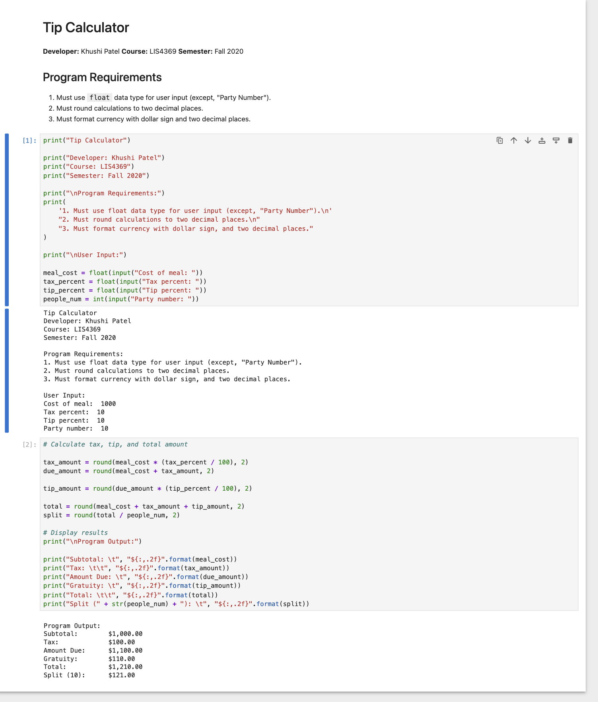
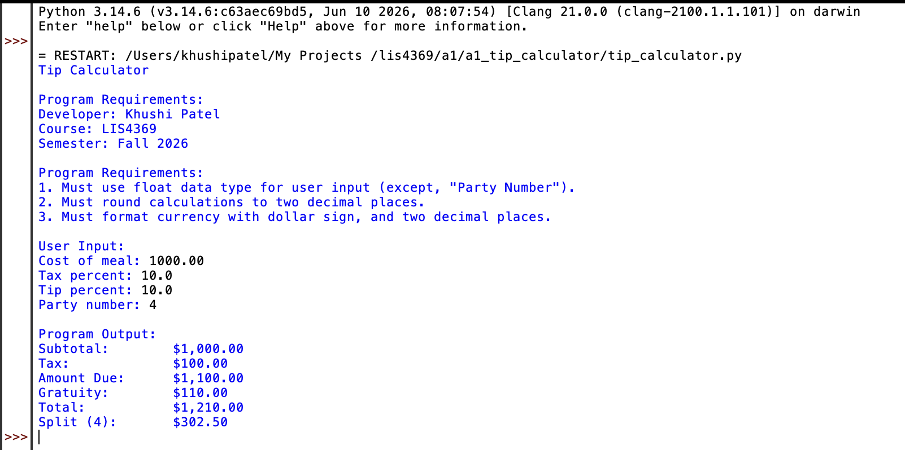
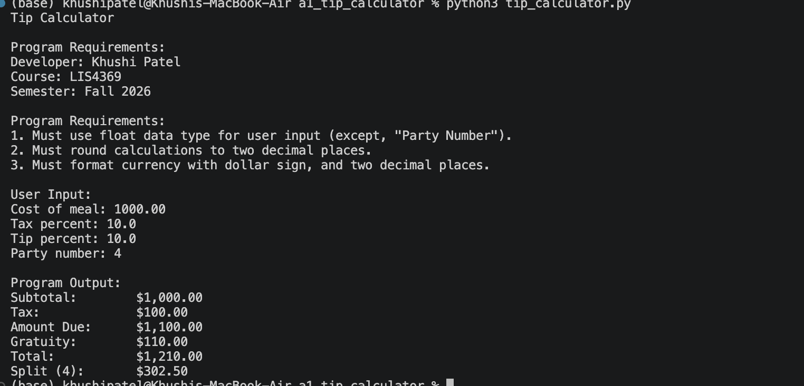

# LIS4369 - Extensible Enterprise Solutions

## Khushi Patel

### Assignment 1 Requirements

_Four Parts:_

1. Distributed Version Control with Git and Bitbucket
2. Development Installations
3. Questions
4. Bitbucket repository links:
   - This assignment
   - Completed Bitbucket tutorial (`bitbucketstationlocations`)

#### README.md File Should Include the Following Items:

- Screenshot of the `a1_tip_calculator` application running
- Screenshot of the Jupyter Notebook
- Git commands with short descriptions
- Assignment screenshots

> This assignment demonstrates the use of Git, Bitbucket, Python, and Jupyter Notebook. The Tip Calculator application calculates tax, gratuity, total cost, and the amount per person.

> #### Git Commands w/Short Descriptions:

1. `git init` - Create a new local repository.
2. `git status` - List the files that have been changed and those that still need to be added or committed.
3. `git add` - Add one or more files to the staging area.
4. `git commit` - Record changes to the repository.
5. `git push` - Send changes to the remote repository.
6. `git pull` - Fetch and merge changes from the remote repository into the working directory.
7. `git clone` - Create a working copy of a remote repository.

##### Tip Calculator Code:

[Tip Calculator Jupyter Notebook](a1_tip_calculator/tip_calculator.ipynb)

#### Assignment Screenshots

_Screenshot of A1 Jupyter Notebook:_

_Screenshot of a1_tip_calculator application running:_

_Screenshot of a1_tip_calculator application running in Visual Studio Code:_

