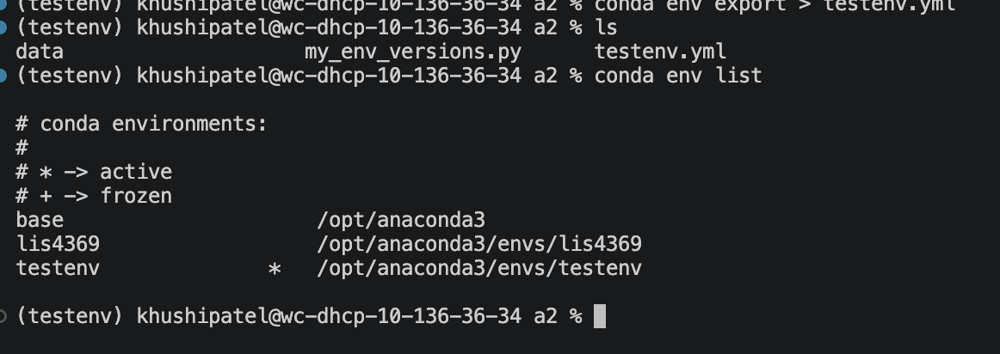
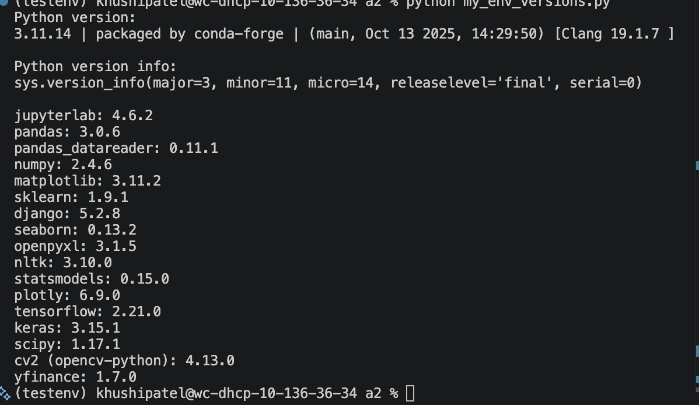
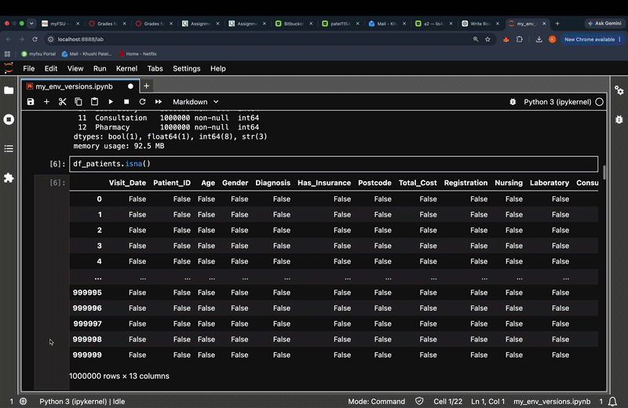

# LIS4369 - Extensible Enterprise Solutions

## Khushi Patel

### Assignment 2 Requirements

_Five Parts:_

1. Get
2. Clean
3. Prepare
4. Analyze
5. Visualize

#### README.md File Should Include the Following Items:

- Screenshot of the Jupyter Notebook
- Screenshot of the `conda env list` command
- Screenshot of `my_env_versions.py` output
- Link to the A2 Jupyter Notebook
- Link to the `testenv.yml` file
- Assignment screenshots

> This assignment demonstrates the use of Python, pandas, Jupyter Notebook, and a conda environment for health care data analysis. The patient data is loaded, cleaned, prepared, analyzed, and visualized.

**#### Data Analysis Steps:**

1. `Get` - Get and inspect the patient data.
2. `Clean` - Clean and rename DataFrame columns.
3. `Prepare` - Save and read the cleaned patient data.
4. `Analyze` - Analyze patient insurance information.
5. `Visualize` - Create a bar chart showing patients with and without insurance.

**##### A2 Jupyter Notebook:**

[A2 Jupyter Notebook](A2.ipynb)

**##### Conda Environment:**

The assignment uses a conda environment named `testenv`.

**##### Environment Files:**

[testenv.yml](testenv.yml)

[my_env_versions.py](my_env_versions.py)

**#### Assignment Screenshots**

_Screenshot of `conda env list`:_

_Screenshot of `my_env_versions.py` output:_

