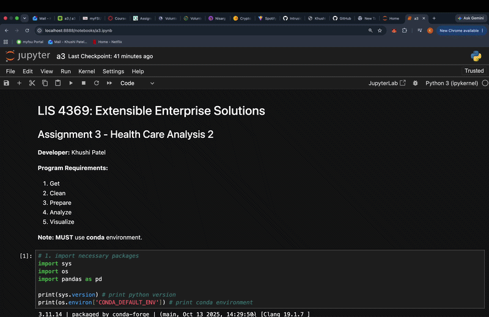

# LIS 4369: Extensible Enterprise Solutions

## Khushi Patel

### Assignment 3 Requirements:

1. Backward-engineer (using Python) the A2 video
2. Utilize cleaned file from past assignment for analysis
3. Ensure Python test environment is used for programming packages
4. 3 skillsets with screenshots and file locations

### README.md file should include the following items:

- Gif of A3 program
- Link to a3.ipynb file
- 3 skillsets with links to functions, home directory, and images/gifs of running programs

### Assignment Screenshots/Gifs:

#### _A3 Reverse-Engineered Program:_ [a3.ipynb](./a3.ipynb)

_A3 Reverse-Engineered Program:_

### Assignment Skillsets:

#### _Skillset 4: Calorie Percentage:_ [SS4 Functions](../skillsets/ss4_calorie_percentage/functions.py)

[SS4 Screenshot](img/SS4 Functions.png)

#### _Skillset 5: Python Selection Structures:_ [SS5 Functions](../skillsets/ss5_python_selection_structures/functions.py)

[SS5 Screenshot](img/SS5 Functions.png)

#### _Skillset 6: Python Loops:_ [SS6 Functions](../skillsets/ss6_python_loops/functions.py)

[SS6 Screenshot](img/SS6 Functions.png)
