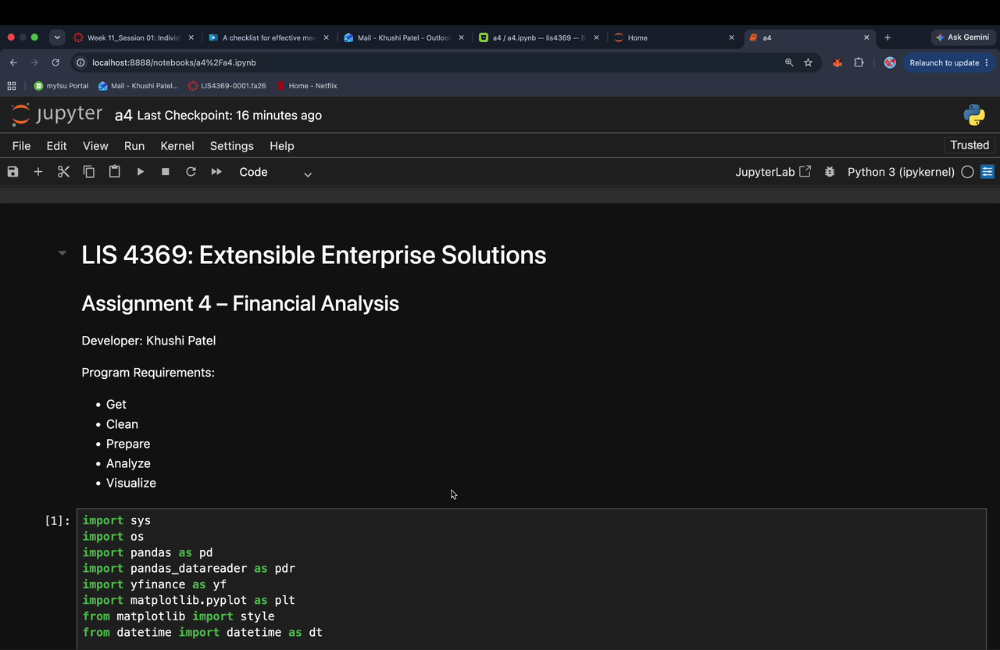
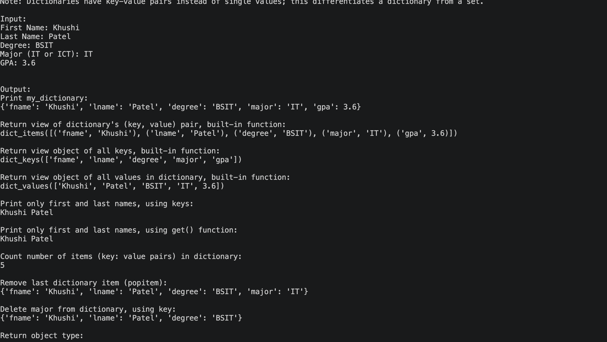
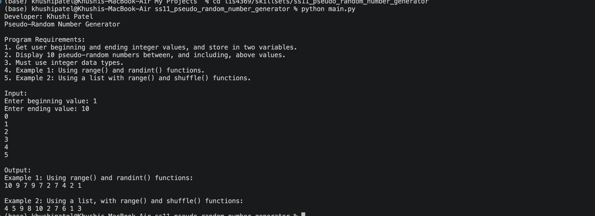
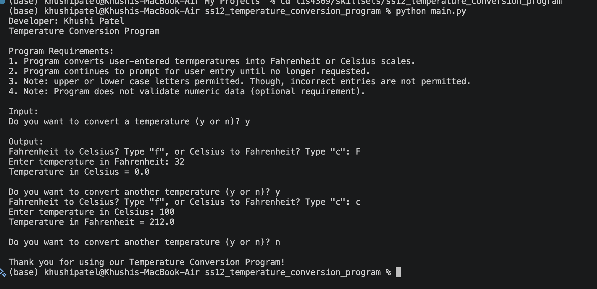

# LIS 4369: Extensible Enterprise Solutions

## Khushi Patel

### Assignment 4 Requirements:

1. Backward-engineer (using Python) the A4 video.
2. Utilize cleaned file from past assignment for analysis.
3. Ensure Python test environment is used for programming packages.
4. Complete 3 skillsets with screenshots and file locations.

### README.md file should include the following items:

- GIF of A4 program.
- Link to a4.ipynb file.
- 3 skillsets with links to functions, home directory, and images/GIFs of running programs.

### Assignment Screenshots/Gifs:

#### _A4 Reverse-Engineered Program:_ [a4.ipynb](./a4.ipynb)

_A4 Reverse-Engineered Program:_

### Assignment Skillsets:

#### _Skillset 10: Calorie Percentage:_ [SS10 Functions](../skillsets/ss10_using_dictionaries/)

#### _Skillset 11: Python Selection Structures:_ [SS11 Functions](../skillsets/ss11_pseudo_random_number_generator/)

#### _Skillset 12: Python Loops:_ [SS12 Functions](../skillsets/ss12_temperature_conversion_program/)

