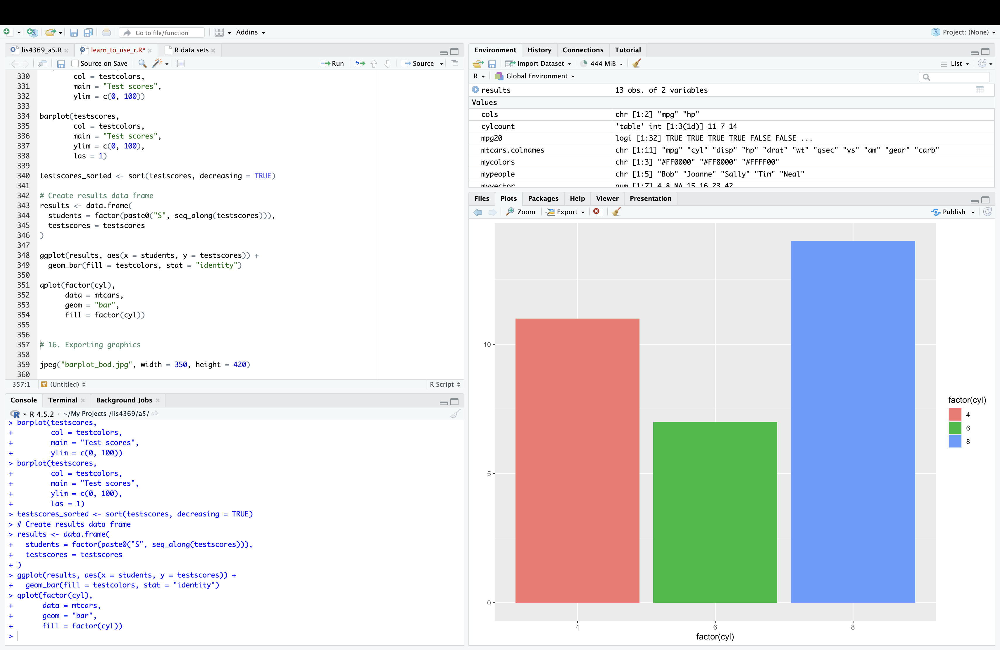
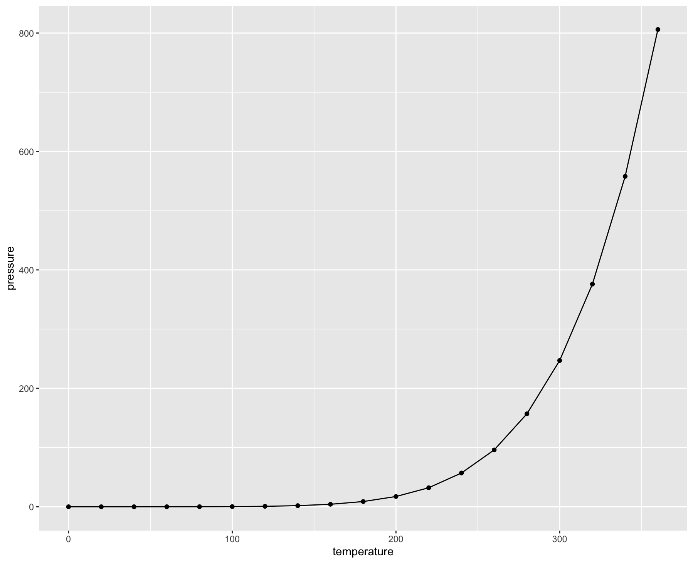
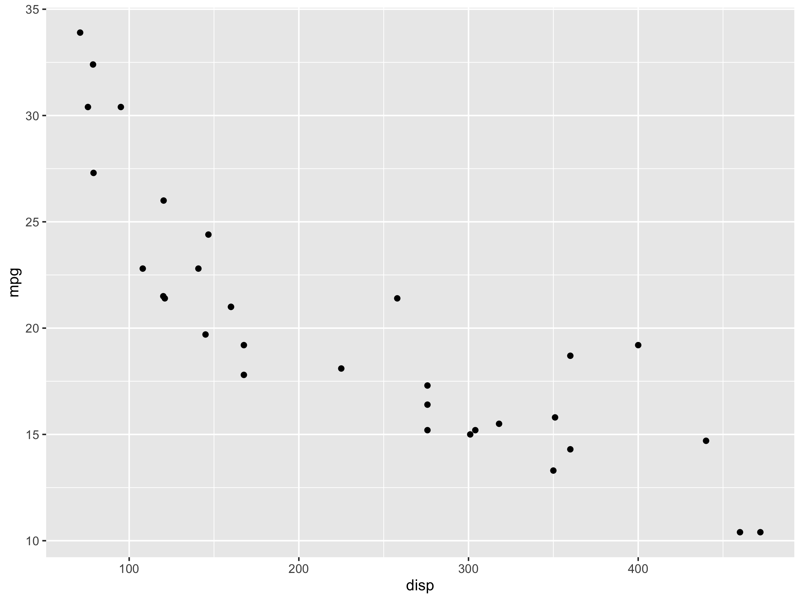
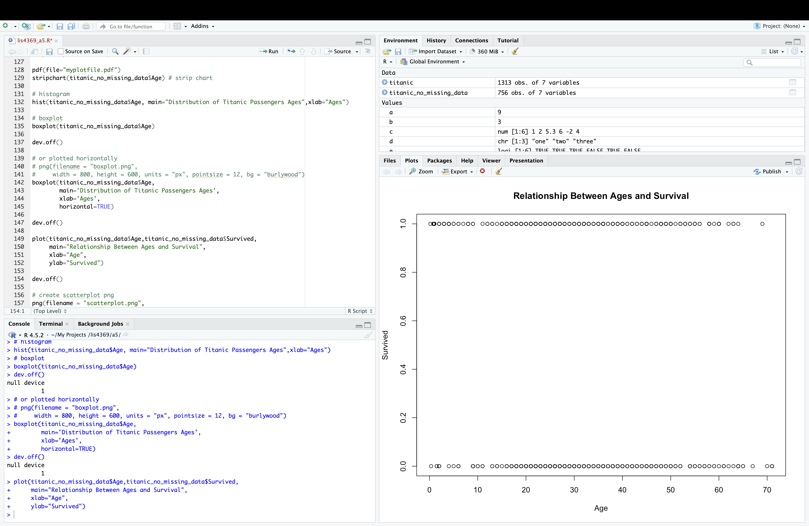
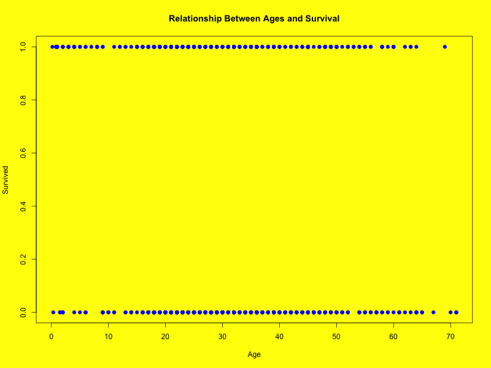
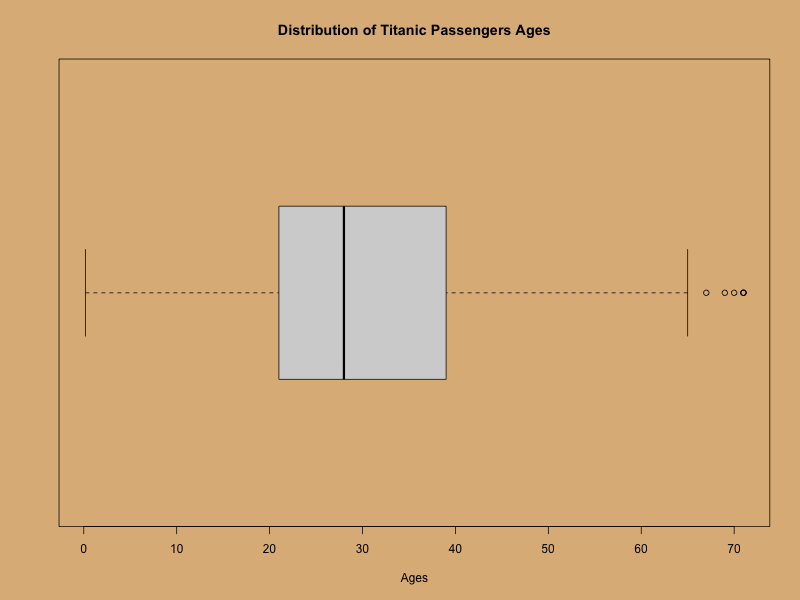

# LIS 4369: Extensible Enterprise Solutions

## Khushi Patel

### Assignment 5 Requirements

1. Complete R Setup and Tutorial.
2. Code and run the R Tutorial program.
3. Code and run the LIS4369 A5 R program.
4. Include at least two 4-panel RStudio screenshots.
5. Include links to both `learn_to_use_r.R` and `lis4369_a5.R` files.
6. Complete and provide terminals of completed skillsets.

---

## Assignment Screenshots and GIFs

### 1. learn_to_use_r.R File

**R File:** [learn_to_use_r.R](learn_to_use_r.R)

### RStudio Screenshot

### Plots

### 2. lis4369_a5.R File

**R File:** [lis4369_a5.R](lis4369_a5.R)

**RStudio Screenshot:**

**Example Plots for lis4369_a5.R:**

---

## 3. Skillsets

### Skillset 13: Python Sphere Volume Calculator

- **Main Directory:** [SS13 Home Directory](../skillsets/ss13_sphere_volume_calculator/)
- **Screenshot:** [SS13 Screenshot](img/SS13.png)

---

### Skillset 14: Python Calculator with Error Handling

- **Main Directory:** [SS14 Home Directory](../skillsets/ss14_calculator_with_error_handling/)
- **Screenshot:** [SS14 Screenshot](img/SS14.png)

---

### Skillset 15: Python File Write Read

- **Main Directory:** [SS15 Home Directory](../skillsets/ss15_file_write_read/)
- **Screenshot:** [SS15 Screenshot](img/SS15.png)

---
